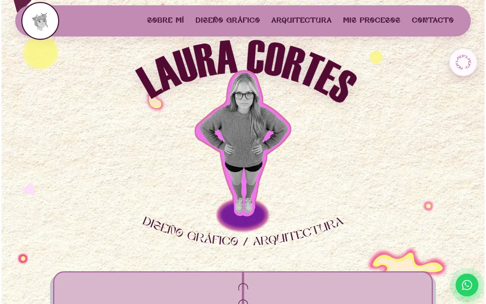
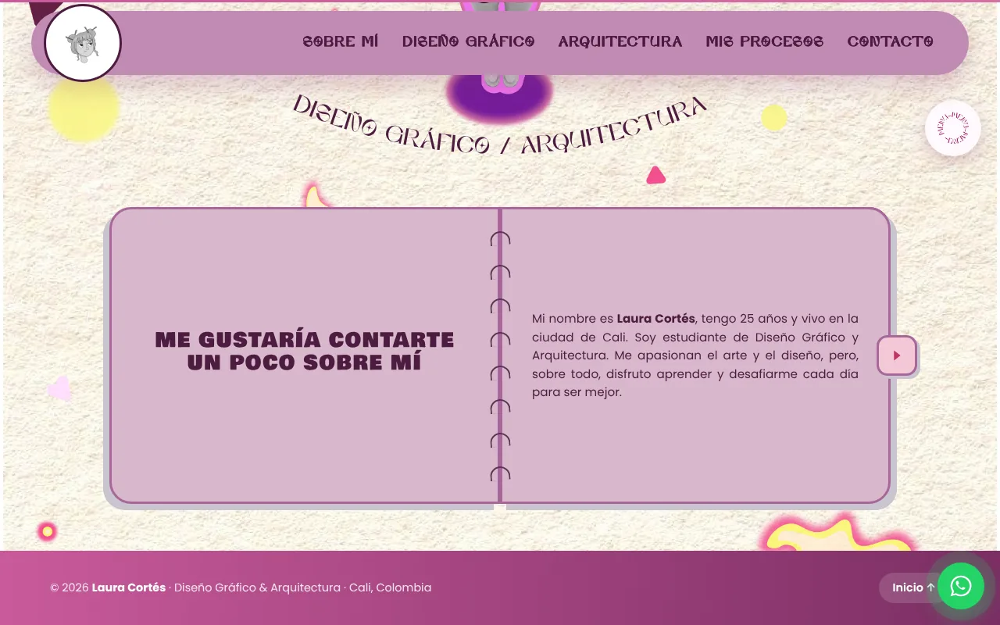
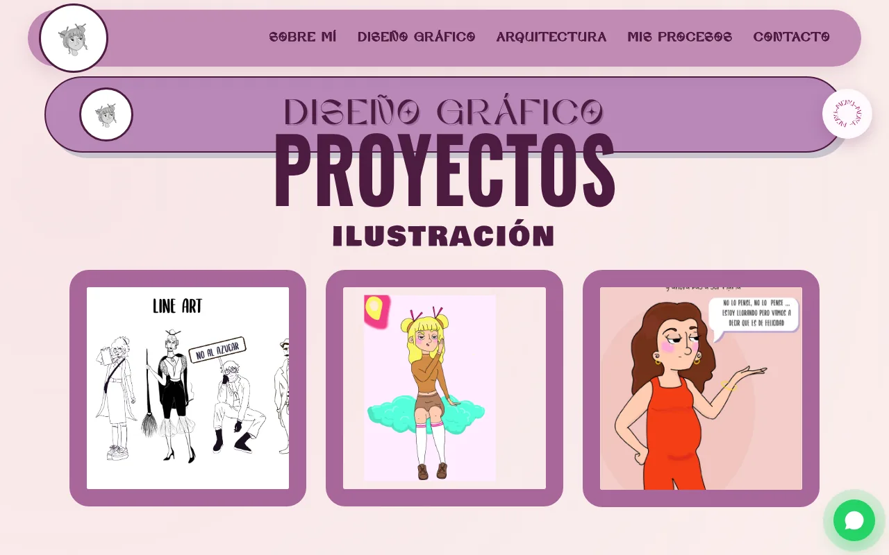
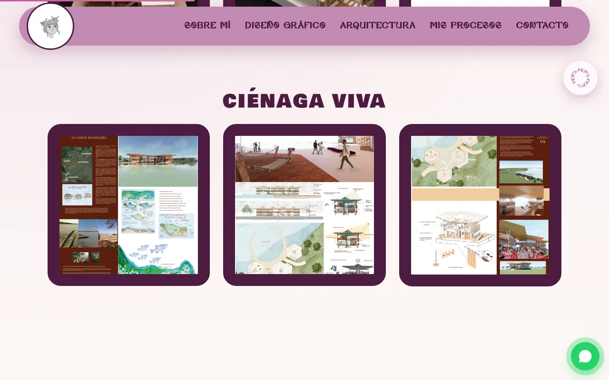
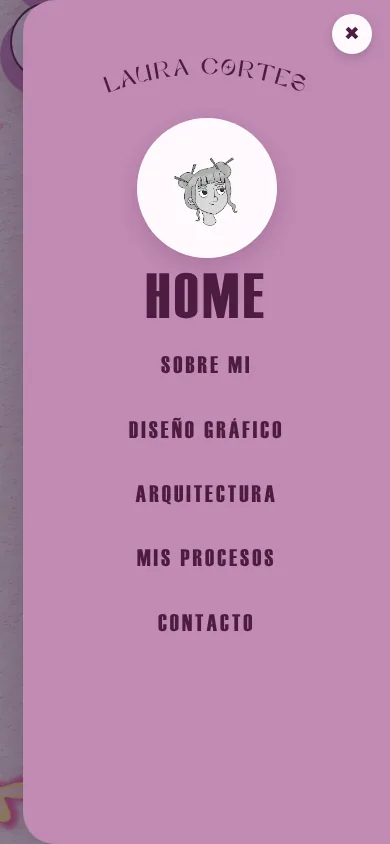

# Portafolio · Laura Cortés

Portafolio web personal de **Laura Cortés**, diseñadora gráfica y arquitecta en formación en Cali, Colombia. Es un sitio estático de cinco páginas que muestra sus proyectos de **diseño gráfico** (ilustración, diseño editorial e identidad) y de **arquitectura** (maquetas y proyectos académicos), junto con su método de trabajo y sus datos de contacto.

Está pensado para clientes, estudios y docentes que quieran conocer su trabajo y escribirle. No usa frameworks, dependencias ni build: HTML, CSS y JavaScript sin librerías.

**Demo en vivo:** https://ronalc90.github.io/ProAle/



---

## Funcionalidades

- **Hero de bienvenida** con título y subtítulo en arco (SVG `textPath`), capas de textura y formas decorativas.
- **Libro "Sobre mí"** con páginas que se voltean usando solo CSS (radio buttons + transformaciones 3D), con presentación, habilidades técnicas (Illustrator, Photoshop, InDesign, Figma, Revit, AutoCAD, Rhino, 3ds Max…) y experiencia.
- **Galerías de proyectos** con varios layouts tipo *collage* en Diseño Gráfico y Arquitectura.
- **Visor de imágenes (lightbox)** a pantalla completa: se abre al pulsar una imagen y se navega con flechas, teclado (`←` `→` `Esc`) o deslizando en el móvil.
- **Menú lateral animado** que se abre con el botón circular flotante, además de la barra de navegación fija y el menú hamburguesa en móvil.
- **Animaciones de aparición** al hacer scroll (`IntersectionObserver`), barra de progreso de lectura y punto que sigue el cursor.
- **Contacto**: correo, Behance, WhatsApp (también con botón flotante) y un formulario que abre el cliente de correo del visitante (`mailto:`).
- Diseño responsive con Grid, Flexbox y `clamp()`.

## Capturas

| Libro "Sobre mí" | Diseño Gráfico |
| --- | --- |
|  |  |

| Arquitectura | Menú en móvil (390 px) |
| --- | --- |
|  |  |

## Páginas

| Página | Archivo | Contenido |
| --- | --- | --- |
| Inicio | [`index.html`](index.html) | Hero de bienvenida + libro "Sobre mí" |
| Diseño Gráfico | [`diseno-grafico.html`](diseno-grafico.html) | Ilustración, diseño editorial, identidad e identidad visual |
| Arquitectura | [`arquitectura.html`](arquitectura.html) | Maquetación, Ciénaga Viva, Casa Sol, Refugio La Orilla |
| Mis Procesos | [`procesos.html`](procesos.html) | Método creativo en 4 pasos |
| Contacto | [`contacto.html`](contacto.html) | Datos y formulario de contacto |

## Stack

- **HTML5** semántico, con atributos ARIA en menús, diálogos y botones.
- **CSS3** en un único archivo comentado ([`css/styles.css`](css/styles.css)): Grid, Flexbox, `clamp()`, variables, `aspect-ratio`, animaciones y `@font-face`.
- **JavaScript** sin librerías ([`js/script.js`](js/script.js)): menús, lightbox, animaciones al hacer scroll, barra de progreso y año dinámico del pie.
- **Google Fonts**: Oswald, Playfair Display, Poppins, Bowlby One SC, Caveat y Abril Fatface.
- **Tipografías locales** en [`fonts/`](fonts): Hatten, Amoria y Swisse.
- **Hosting**: GitHub Pages.

## Cómo correrlo en local

No hay dependencias que instalar. Puedes abrir `index.html` directamente en el navegador, aunque es mejor servirlo por HTTP para que las rutas y las tipografías se carguen igual que en producción:

```bash
git clone https://github.com/ronalc90/ProAle.git
cd ProAle

# Opción 1: Python (viene con casi cualquier sistema)
python3 -m http.server 8080

# Opción 2: con recarga automática al guardar
npx live-server --port=8080
```

Luego abre http://localhost:8080.

## Despliegue

El sitio se publica con **GitHub Pages** desde la rama `main` (carpeta raíz). Cada push a `main` lanza el flujo automático *pages build and deployment* y, en uno o dos minutos, los cambios aparecen en https://ronalc90.github.io/ProAle/. El archivo `.nojekyll` evita que Pages procese el sitio con Jekyll.

Como todo es estático, también puede desplegarse tal cual en Netlify, Vercel o cualquier servidor web: basta con publicar la raíz del repositorio.

## Estructura de carpetas

```
ProAle/
├── index.html              ← Inicio
├── diseno-grafico.html
├── arquitectura.html
├── procesos.html
├── contacto.html
├── css/
│   └── styles.css          ← Estilos globales (con índice y comentarios)
├── js/
│   └── script.js           ← Interacciones del sitio
├── img/                    ← Imágenes de los proyectos, iconos y fondos
├── fonts/                  ← Tipografías locales
├── referencia/             ← Imágenes de referencia del diseño (no las usa el sitio)
└── docs/capturas/          ← Capturas de este README
```

> Algunas rutas de imágenes tienen espacios y tildes (por ejemplo `img/diseño grafico/`). En el HTML se escriben codificadas (`%20`), así que si agregas imágenes nuevas conviene usar nombres sin espacios.

## Autora

**Laura Cortés**, Cali, Colombia
[Behance](https://www.behance.net/alejap321489c) · [WhatsApp](https://wa.me/573012734251) · lauraalejandracortesortegate@gmail.com
